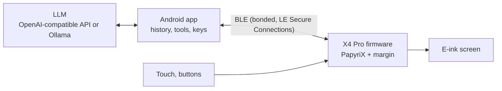

# margin

Custom firmware for the **Xteink X4 Pro** e-ink reader that combines a full e-reader with an
**agentic chat client**, paired over **Bluetooth Low Energy** with a companion **Android app**.
The phone is the brain; the reader is a calm, paper-like terminal for reading and for talking to
your agent in the margins of what you read.

> **Status: scaffold. Nothing works on a device yet.** The firmware compiles and links for the X4 Pro
> and the protocol code is unit-tested on both sides, but none of it has been flashed or run.
> See [docs/ROADMAP.md](docs/ROADMAP.md).

Inspired by Snail OS, which is closed-source and cannot be used as a base. margin builds on the
open-source [PapyriX](https://github.com/bigbag/papyrix-reader) reader firmware instead.

## Features (planned)

- **E-reader**: everything PapyriX does on the X4 Pro: EPUB, FB2, Markdown, TXT, HTML, XTC; custom
  fonts and themes; microSD library; touch; warm/cool front light.
- **Chat screen**: streamed replies with coalesced e-ink refreshes, a "thinking" status line, a touch
  keyboard and quick replies, and the page buttons for scrolling.
- **Phone as the brain**: the Android app talks to any OpenAI-compatible API or a local **Ollama**
  server, runs tools, keeps history and API keys, and cleans text for e-ink. No API keys or HTTPS on
  the reader, and Wi-Fi can stay off.
- **Ask about a passage**: select text while reading, then Explain / Summarise / Define / Translate /
  Ask, and the answer appears in Chat.
- **Send to reader**: push articles and books from the phone onto the SD card over BLE.
- **Sync**: bookmarks, highlights and reading progress flow back to the app.

## How it fits together



More in [docs/ARCHITECTURE.md](docs/ARCHITECTURE.md). The wire format is in
[docs/BLE_PROTOCOL.md](docs/BLE_PROTOCOL.md).

## Hardware

Xteink **X4 Pro** only: ESP32-S3 (240 MHz dual core), 8 MB PSRAM, 16 MB flash, 4.3" 800×480 e-paper
(219 PPI) whose controller varies by unit (UC8179 / UC8279 / SSD1677, detected at boot), GT911
capacitive touch, warm/cool front light, side page buttons and a capacitive home key, 1100 mAh
battery, 2.4 GHz Wi-Fi + Bluetooth LE. USB only through the pogo-pin dongle. It is **not** the
ESP32-C3 X4/X3. Details, sources and open questions: [docs/HARDWARE.md](docs/HARDWARE.md).

## ⚠️ Before you flash anything

1. **Back up the full 16 MB flash** of the stock firmware. Xteink offers **no official firmware
   download to restore**, so your backup is the only way back:
   `esptool --chip esp32s3 --port /dev/ttyACM0 read-flash 0 0x1000000 x4pro-stock-16MB.bin`
2. **Buy direct from xteink.com.** Xteink says units bought there are exempt from third-party
   firmware restrictions; some marketplace units are USB-locked.
3. **Plug in the pogo-pin dongle.** Without it the X4 Pro does not show up over USB at all.
4. **Hold Power during flashing** on the X4 Pro (the bootloader does not hold the power latch), and
   release it once the new firmware has booted.

Flashing third-party firmware is at your own risk.

## Quick start (developers)

```bash
git clone --recurse-submodules https://github.com/yakovkhalinsky/margin
cd margin

# Firmware: host tests (just a C++17 compiler)
make -C firmware/test

# Firmware: device build (PlatformIO)
pip install platformio
firmware/scripts/setup.sh
cd firmware/upstream/papyrix-reader && pio run -e margin_x4pro
# flash: pio run -e margin_x4pro --target upload   (backup first, hold Power)

# Android: open android/ in Android Studio (see android/README.md)
```

## Repository layout

```
docs/       ARCHITECTURE, BLE_PROTOCOL, HARDWARE, ROADMAP, UPSTREAM (base + licences)
firmware/   PapyriX submodule, hook patches, margin libraries, host tests  → firmware/README.md
android/    Kotlin + Jetpack Compose companion app                         → android/README.md
```

## Base and licence

- Base: PapyriX as a **pinned git submodule** plus a tiny patch series, not a long-lived fork. The
  reasons, and the alternative ([CrossPoint Reader](https://github.com/crosspoint-reader/crosspoint-reader)),
  are in [docs/UPSTREAM.md](docs/UPSTREAM.md).
- margin's own code is **MIT** ([LICENSE](LICENSE)). PapyriX is MIT too, but it bundles some
  **GPL-3.0-or-later** files that end up in the firmware image, so **distributed firmware binaries
  must follow GPL-3.0 terms** (ship the complete source). Source-level, margin stays MIT. See
  [NOTICE](NOTICE) and [docs/UPSTREAM.md](docs/UPSTREAM.md#licences).
