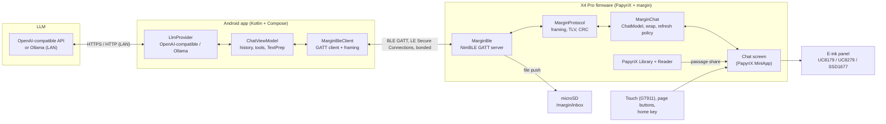

# Architecture

margin splits the work so the e-ink reader stays small, quiet and secret-free:

- **Phone = brain.** The Android app talks to the LLM (any OpenAI-compatible API, or Ollama on your
  own machine), runs tools, keeps history and API keys, and cleans text for e-ink.
- **Reader = calm terminal.** The X4 Pro runs PapyriX's e-reader plus a Chat screen. It renders text,
  takes input (touch keyboard, quick replies, page buttons) and shares passages. No API keys, no
  HTTPS, no LLM code; Wi-Fi can stay off.
- **BLE in between**, with a small versioned protocol ([BLE_PROTOCOL.md](BLE_PROTOCOL.md)).



## Firmware layering

```
firmware/
  upstream/papyrix-reader/   PapyriX, pinned git submodule (MIT; contains some GPL-3.0 files)
  patches/                   small hook patches applied to the submodule by scripts/setup.sh
  platformio.margin.ini      margin envs, linked into the submodule as platformio.local.ini
  lib/MarginProtocol/        pure C++17: framing, reassembly, CTRL, TLV, CRC32   (host-tested)
  lib/MarginChat/            pure C++17: ChatModel, wrapText, RefreshPolicy      (host-tested)
  lib/MarginBle/             NimBLE-Arduino 2.x GATT server                     (device only)
  lib/MarginApp/             Chat screen as a PapyriX MiniApp                    (device only)
  test/                      host unit tests (make -C firmware/test)
```

- **Threading.** NimBLE callbacks run on the NimBLE host task; they only copy raw packets into a
  FreeRTOS queue. Reassembly, ACKs, dispatch and sending happen in `Service::poll()`, called from the
  PapyriX main loop via the Chat app's `update()`. UI state is never touched from the BLE task.
- **Memory.** Reassembly and TX buffers (64 KiB each) and the 32 KiB chat transcript arena live in
  PSRAM (`heap_caps_malloc(MALLOC_CAP_SPIRAM)`). The pure libraries never allocate; callers pass buffers.
- **Screens.** PapyriX is a state machine (`StateId`: Home, FileList, Reader, Settings, AppLauncher…)
  with "mini apps" (`MiniApp` table) launched from the app launcher. margin's Chat starts as a
  MiniApp because that hooks in with a one-file patch. It moves to its own `StateId`
  (Home → Chat shortcut, Reader → "Ask about selection") in M3/M5 when deeper hooks are needed.
- **Refresh.** `RefreshPolicy` coalesces streaming updates (≤ 1 refresh / 400 ms, flush on CHAT_DONE)
  and forces a full/half refresh every N fast ones to clear ghosting. True region updates are a
  research item, see [HARDWARE.md](HARDWARE.md#refresh-behaviour-matters-for-streaming-chat).
- **Radio policy.** BLE runs while the Chat screen is open (scaffold). Target: a "Phone link" setting
  that keeps BLE advertising at a slow interval in the background so file push and sync work while
  reading, with Wi-Fi features (LocalSend, Calibre, web server) still available on demand.

## Android layering

```
android/app/src/main/java/dev/margin/
  protocol/   Protocol, Framing (Fragmenter/Reassembler/Ctrl), Tlv, Messages   (JVM-tested)
  ble/        MarginBleClient: GATT client using the protocol package
  llm/        LlmProvider + OpenAiCompatibleProvider (SSE) + OllamaProvider (NDJSON)
  chat/       ChatViewModel (history, LLM loop, mirroring to the reader), TextPrep (e-ink cleanup)
  ui/         ChatScreen (Compose)
```

## Cross-features

| Feature | Device | Phone | Protocol |
|---|---|---|---|
| Chat | Chat screen, keyboard, quick replies | LLM loop, history | CHAT_DELTA / DONE / THINKING_STATUS / QUICK_REPLIES / USER_MESSAGE / CHAT_CANCEL |
| Ask about a passage | Reader selection → intent menu | builds the prompt with book context | PASSAGE_SHARE |
| Send to reader | writes `/margin/inbox/`, shows in Library | share-sheet target for articles/books (article → Markdown/EPUB conversion on phone) | FILE_OFFER / FILE chunks / FILE_COMPLETE / FILE_RESULT |
| Bookmarks & highlights | change log with monotonically increasing `seq` | stores, searchable, exportable | SYNC_REQUEST / SYNC_RECORDS / SYNC_DONE / SYNC_ACK |

## Why not do the LLM on the reader?

The ESP32-S3 could make HTTPS calls over Wi-Fi, but that would put API keys on a device with no
secure element, add TLS and JSON streaming to a tight firmware, and keep Wi-Fi on, which costs
battery. The phone already has the network, the keys and the CPU, and a local Ollama server is only
reachable from the LAN anyway. The reader only ever sees plain text.
